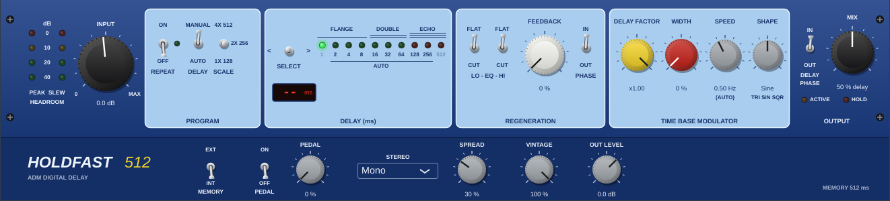

## 1. Introduzione

Holdfast 512 è un delay digitale ispirato ai rack ADM dei primi anni '80 da 1 a 512 ms. Riproduce il
modo in cui quelle macchine lavoravano: l'audio viene convertito in un flusso a 1 bit da un modulatore
delta adattivo (ADM), scritto in una memoria e riletto a un clock variabile. Per questo, quando il
tempo di ritardo cambia, cambia anche l'intonazione delle ripetizioni, come su un nastro a velocità
variabile, e il suono ha la grana morbida e un po' "analogica" tipica di questi apparecchi.

Le caratteristiche principali:

- dieci tempi di ritardo a ottave, da 1 a 512 ms, scelti con **SCALE** e **SELECT**;
- **AUTO**, che fa scorrere i tempi su e giù a ritmo del modulatore;
- rigenerazione con taglio dei bassi e degli acuti e fase commutabili;
- un modulatore (VCO) con forma continua da triangolo a sinusoide a quadra;
- **REPEAT**, che congela il contenuto della memoria e lo ripete senza perdite;
- memoria esterna da 2,5 s, coppia stereo di due unità, pedale di controllo.

Il pannello è disegnato in codice e non usa loghi né nomi di marchi. Holdfast 512 condivide il motore
ADM con Slopebox 1024, con una configurazione diversa.

## 2. Installazione

Holdfast 512 esiste in tre formati:

| Sistema | Formato | Cartella |
|---------|---------|----------|
| macOS | Audio Unit (Logic, GarageBand, MainStage…) | `~/Library/Audio/Plug-Ins/Components/Holdfast 512.component` |
| macOS | VST3 | `~/Library/Audio/Plug-Ins/VST3/Holdfast 512.vst3` |
| macOS | Applicazione Standalone | `Holdfast 512.app`, dove preferisci (per esempio Applicazioni) |
| Windows | VST3 | `C:\Program Files\Common Files\VST3\Holdfast 512.vst3` |
| Windows | Standalone | `Holdfast 512.exe`, dove preferisci |

Dopo aver copiato i file, riapri il programma musicale o fai rifare la scansione dei plugin. In Logic
Holdfast 512 compare tra gli effetti Audio Unit sotto **Slopebox Audio › Holdfast 512**.

Il plugin accetta ingressi mono o stereo e ha uscita stereo (o mono su una traccia mono). Con un
ingresso stereo in modalità **Mono** i due canali vengono sommati prima del ritardo, mentre il segnale
diretto resta stereo.

Nella versione Standalone, se ingresso e uscita sono sullo stesso dispositivo, l'ingresso audio parte
silenziato per evitare un innesco: riattivalo da **Settings…**.

Cambiare **MEMORY** da INT a EXT (o viceversa) riorganizza la memoria: per un istante l'audio si ferma
e il contenuto del ritardo si azzera.

## 3. Il pannello

Il pannello è diviso in due parti. Quella superiore riprende i comandi dell'apparecchio originale, da
sinistra a destra: **ingresso**, **PROGRAM**, **DELAY**, **REGENERATION**, **TIME BASE MODULATOR** e
**OUTPUT**. La fascia inferiore contiene le aggiunte del plugin: memoria, pedale, stereo, carattere e
livello d'uscita.

Le levette si azionano con un clic: quelle a due posizioni scattano a ogni clic, quella a tre posizioni
(SCALE) sale o scende di un passo verso il punto cliccato. Funzionano anche il trascinamento, la rotella
del mouse e il clic direttamente sulle scritte accanto alla levetta. Le manopole si girano trascinando
in su e in giù; il doppio clic le riporta al valore iniziale.

### 3.1 Ingresso

| Comando | Funzione | Valori |
|---------|----------|--------|
| INPUT | Livello d'ingresso. È il comando più importante per il suono: regolalo guardando la scala HEADROOM. | −24 … +26 dB, iniziale 0 dB |
| HEADROOM PEAK | LED di picco a 40, 20, 10 e 0 dB sotto il limite. A 0 dB inizia la saturazione, con circa 6 dB di margine. | — |
| HEADROOM SLEW | Indica quanto il segnale è "ripido" (ricco di acuti forti). A 0 dB il modulatore delta non riesce più a seguirlo e gli acuti si impastano. | — |

Regola INPUT in modo che PEAK arrivi a 10 dB e tocchi 0 dB solo sui picchi. Se SLEW si accende spesso
a 0 dB ma PEAK no, il segnale è molto brillante: abbassa un po' INPUT, oppure accetta la grana come parte
del carattere.

### 3.2 PROGRAM

| Comando | Funzione | Valori |
|---------|----------|--------|
| REPEAT | ON stacca l'ingresso e fa girare all'infinito l'intera memoria, bit per bit, senza perdita. Il LED verde accanto e il LED HOLD nell'uscita lo segnalano. | OFF / ON |
| DELAY | MANUAL: il tempo si sceglie con SELECT. AUTO: il tempo scorre da solo nella finestra di SCALE (vedi 3.3). | MANUAL / AUTO |
| SCALE | Sceglie quali otto dei dieci tempi sono raggiungibili. | 1X: 1–128 ms · 2X: 2–256 ms · 4X: 4–512 ms; iniziale 2X |

Durante REPEAT il **DELAY FACTOR** cambia ancora la durata e l'intonazione del loop: girandolo si
ottengono effetti di rallentamento e accelerazione fino a due ottave.

### 3.3 DELAY

| Comando | Funzione | Valori |
|---------|----------|--------|
| SELECT | Levetta a ritorno: a sinistra accorcia il ritardo di un'ottava, a destra lo allunga, dentro la finestra di SCALE. Puoi anche cliccare direttamente il LED del tempo voluto. | 8 passi |
| LED dei tempi | 1, 2, 4, 8, 16, 32, 64 ms (verdi) e 128, 256, 512 ms (rossi). Quelli fuori dalla finestra di SCALE hanno l'etichetta grigia e non sono selezionabili. | — |
| FLANGE / DOUBLE / ECHO | Indicano a che tipo di effetto corrispondono i tempi: 1–8 ms flanger, 16–64 ms raddoppio e chorus, 128–512 ms eco. | — |
| AUTO | La barra sotto i LED indica la finestra percorsa in AUTO. | — |
| Display ms | Il tempo di ritardo reale in quel momento, cioè tempo scelto × DELAY FACTOR, compreso l'effetto del modulatore. | — |

Per ottenere 512 ms: SCALE su **4X**, DELAY su **MANUAL**, SELECT tutto a destra, DELAY FACTOR a ×1.

In **AUTO** i tempi della finestra vengono percorsi avanti e indietro (dal più corto al più lungo e
ritorno), un passo per ogni ciclo del modulatore. La velocità dei passi si regola con **SPEED**; in
questa modalità SELECT e i clic sui LED sono ignorati.

### 3.4 REGENERATION

| Comando | Funzione | Valori |
|---------|----------|--------|
| FEEDBACK | Quanta parte dell'uscita ritardata rientra nel ritardo. A 0 % una sola ripetizione; al massimo le ripetizioni durano a lungo, appena sotto l'autooscillazione. | 0 … 100 %, iniziale 0 % |
| LO EQ | Solo nel feedback: CUT taglia i bassi sotto 175 Hz, così le ripetizioni non si impastano. | FLAT / CUT |
| HI EQ | Solo nel feedback: CUT taglia gli acuti sopra 3,3 kHz, per ripetizioni scure come un'eco a nastro. | FLAT / CUT |
| PHASE | IN: il feedback rientra in fase. OUT: in controfase, che con i tempi corti cambia il colore del flanger (picchi e buchi si scambiano). | IN / OUT |

Anche con EQ su FLAT ogni ripetizione perde un po' di acuti (circa 1 dB tra 3 e 8 kHz), come
sull'originale.

### 3.5 TIME BASE MODULATOR

Il modulatore varia il clock della memoria, quindi il tempo di ritardo e l'intonazione delle
ripetizioni. È quello che produce flanger, chorus e vibrato.

| Comando | Funzione | Valori |
|---------|----------|--------|
| DELAY FACTOR | Moltiplica il tempo scelto. Girandolo cambia anche l'intonazione, come variando la velocità di un nastro. Con WIDTH alzato fa da centro della modulazione. | ×0,25 … ×1, iniziale ×1 |
| WIDTH | Profondità della modulazione. Al massimo il ritardo percorre tutto il rapporto 4:1. | 0 … 100 %, iniziale 0 % |
| SPEED | Velocità del modulatore. In AUTO è anche la velocità dei passi. | 0,05 … 10 Hz, iniziale 0,5 Hz |
| SHAPE | Forma dell'onda, continua: tutto a sinistra triangolo (TRI), al centro sinusoide (SIN), tutto a destra quadra (SQR), e tutte le forme intermedie. | iniziale sinusoide |

Con la forma quadra il ritardo salta tra due valori: con tempi medi si ottiene un trillo, con tempi
lunghi un'eco che alterna due intonazioni.

### 3.6 OUTPUT

| Comando | Funzione | Valori |
|---------|----------|--------|
| DELAY PHASE | IN: il segnale ritardato esce in fase. OUT: in controfase. Con MIX a metà e tempi corti, OUT produce un flanger "scavato" con il taglio dei bassi. | IN / OUT |
| MIX | Miscela tra segnale diretto (SOURCE, tutto a sinistra) e ritardato (DELAY, tutto a destra). | 0 … 100 %, iniziale 50 % |
| ACTIVE | Arancione: c'è segnale in ingresso. | — |
| HOLD | Rosso: REPEAT è attivo. | — |

Per usare Holdfast 512 in una mandata (send) di effetti, porta MIX tutto su DELAY.

### 3.7 Fascia inferiore: aggiunte del plugin

| Comando | Funzione | Valori |
|---------|----------|--------|
| MEMORY | INT: memoria standard da 512 ms. EXT: simula il modulo di memoria esterna, il tempo più lungo diventa 2,5 s. | INT / EXT |
| PEDAL | Con la levetta su ON la manopola PEDAL prende il posto di DELAY FACTOR, come un pedale d'espressione collegato all'ingresso di controllo: 0 % = ×1, 100 % = ×0,25. WIDTH continua ad aggiungere la modulazione. Puoi automatizzarla o collegarla a un controller MIDI. | OFF / ON, 0 … 100 % |
| STEREO | Mono: una sola unità sulla somma degli ingressi, ritardato uguale sui due lati. Linked Pair: due unità indipendenti, una per lato, come due rack accoppiati. | Mono / Linked Pair |
| SPREAD | Solo in Linked Pair: quanto l'unità destra è "starata" rispetto alla sinistra (DELAY FACTOR più corto fino al 18 %, SPEED più veloce fino al 27 %), come due apparecchi regolati a mano. | 0 … 100 %, iniziale 30 % |
| VINTAGE | Quantità del carattere dell'originale: grana della conversione ADM e il leggero soffio di fondo. A 0 % stessa catena con memoria pulita e senza soffio. | 0 … 100 %, iniziale 100 % |
| OUT LEVEL | Livello d'uscita del plugin. | −24 … +12 dB, iniziale 0 dB |

## 4. Flusso del segnale

Il percorso del segnale segue lo schema dell'apparecchio originale:

1. **INPUT** regola il livello; i LED HEADROOM controllano picchi e pendenza.
2. Una **pre-enfasi** alza gli acuti, poi il segnale si somma al **feedback** e passa per un filtro
   passa-basso che limita la banda a circa 15 kHz.
3. Il **modulatore delta adattivo** converte l'audio in un flusso a 1 bit.
4. I bit entrano in una **memoria** da 131 072 celle (640 000 con MEMORY EXT) e vengono riletti alla
   presa scelta con SCALE e SELECT.
5. Un unico **clock** (256 kHz a ×1, fino a 1,024 MHz a ×0,25) guida conversione e memoria. DELAY FACTOR,
   modulatore e PEDAL agiscono su questo clock: per questo il tempo e l'intonazione cambiano insieme.
6. **Decodifica**, filtro di ricostruzione e **de-enfasi** riportano il segnale all'audio normale.
7. Il segnale ritardato torna all'ingresso attraverso **FEEDBACK**, gli **EQ** LO e HI e la **PHASE** del
   feedback.
8. **DELAY PHASE** e **MIX** lo miscelano con il segnale diretto; **OUT LEVEL** regola l'uscita.

Con **REPEAT** su ON l'ingresso e il feedback sono esclusi: la memoria gira su se stessa senza essere
riscritta, quindi il loop non perde qualità per quanto a lungo lo lasci andare.

## 5. Impostazioni di esempio

Partendo dai valori iniziali (doppio clic su ogni manopola), cambia solo quanto indicato.

| Effetto | Impostazioni | Note |
|---------|----------------------------------------------|------------------------|
| Flanger classico | 1X / 2 ms · DELAY FACTOR ×0,5 · WIDTH 100 % · SPEED 0,2 Hz · SHAPE TRI · FEEDBACK 70 % · MIX 50 % | Prova PHASE su OUT per un colore diverso |
| Flanger "jet" profondo | 1X / 1 ms · DELAY FACTOR ×1 · WIDTH 100 % · SPEED 0,1 Hz · SHAPE TRI · FEEDBACK 85 % · MIX 50 % | DELAY PHASE OUT per un suono più scavato |
| Chorus | 2X / 16 ms · DELAY FACTOR ×0,6 · WIDTH 15 % · SPEED 0,7 Hz · SHAPE SIN · FEEDBACK 20 % · MIX 50 % | In stereo: Linked Pair, SPREAD 50 % |
| Raddoppio (doubling) | 2X / 32 ms · DELAY FACTOR ×1 · WIDTH 5 % · SPEED 0,3 Hz · SHAPE SIN · FEEDBACK 0 % · MIX 45 % | Voce o chitarra ritmica |
| Vibrato | 2X / 32 ms · DELAY FACTOR ×0,5 · WIDTH 30 % · SPEED 5 Hz · SHAPE SIN · FEEDBACK 0 % · MIX 100 % | Solo ritardato, nessun segnale diretto |
| Trillo | 2X / 64 ms · DELAY FACTOR ×0,5 · WIDTH 60 % · SPEED 4 Hz · SHAPE SQR · FEEDBACK 0 % · MIX 100 % | Salta tra due intonazioni |
| Slapback | 4X / 128 ms · DELAY FACTOR ×0,8 · WIDTH 0 % · FEEDBACK 0 % · MIX 40 % | Rockabilly, voci anni '50 |
| Eco lunga | 4X / 512 ms · DELAY FACTOR ×0,8 · WIDTH 0 % · FEEDBACK 60 % · MIX 40 % | HI EQ su CUT per un'eco più scura |
| Eco con AUTO | 4X, DELAY AUTO · DELAY FACTOR ×1 · WIDTH 0 % · SPEED 0,5 Hz · FEEDBACK 40 % · MIX 40 % | I tempi cambiano a ogni ciclo |
| Loop con REPEAT | 4X / il più lungo (2,5 s con MEMORY EXT) · DELAY FACTOR ×1 · WIDTH 0 % · FEEDBACK 0 % · MIX 50 % | Suona, poi REPEAT ON; gira DELAY FACTOR |

## 6. Consigli

- **Il livello d'ingresso conta.** Il modulatore delta lavora meglio con un segnale robusto: con INPUT
  troppo basso il suono è più granuloso, con INPUT troppo alto gli acuti forti si impastano (LED SLEW).
- **Flanger e tempi cortissimi.** Il flanger si ottiene sui tempi da 1 a 8 ms con WIDTH alto e un po' di
  FEEDBACK. Con PHASE del feedback su OUT i picchi del filtro a pettine si spostano e il suono diventa più
  cavo.
- **Ripetizioni pulite.** Se le ripetizioni rimbombano, metti LO EQ su CUT. Per un'eco morbida, alla
  maniera del nastro, metti HI EQ su CUT.
- **Autooscillazione.** Con FEEDBACK al massimo, tempi corti e un po' di WIDTH e SPEED si ottengono
  oscillazioni e fischi controllati. Tieni basso OUT LEVEL mentre sperimenti.
- **Effetti di nastro.** Girando DELAY FACTOR mentre le ripetizioni suonano, l'intonazione scende o sale
  come un nastro che rallenta o accelera.
- **Stereo largo.** Linked Pair con SPREAD tra 30 e 60 % trasforma un chorus o un flanger mono in un
  effetto stereo ampio, con le due unità che si muovono a velocità diverse.
- **Automazione.** Tutti i comandi sono automatizzabili. La manopola PEDAL, con la levetta su ON, è la
  più comoda da collegare a un pedale d'espressione MIDI.

## 7. Differenze dall'originale

Holdfast 512 segue il manuale dell'apparecchio originale, ma alcune cose sono diverse o stimate:

- **Stime.** Il manuale non riporta la frequenza del clock, la pre-enfasi, la soglia di SLEW e come il
  modulo di memoria esterna si distribuisce sulle prese: sono valori ricostruiti. Banda, perdita di acuti
  per ripetizione e soffio di fondo sono stati tarati su registrazioni di apparecchi originali.
- **Aggiunte.** OUT LEVEL, VINTAGE, la manopola PEDAL (al posto del pedale collegato al retro), la
  modalità Linked Pair (al posto di due apparecchi collegati con un cavo) e la scelta dei tempi con un
  clic sui LED non esistevano sull'originale.
- **Pedali.** I pedali di bypass e repeat dell'originale sono sostituiti dal bypass del programma
  musicale e dall'automazione di REPEAT.
- **Mono.** Come l'originale, in modalità Mono il ritardo è mono; lo stereo vero si ottiene solo con
  Linked Pair.
- **Niente rumori di commutazione.** Cambiare tempo o SCALE non produce i clic dell'hardware.

## 8. Specifiche

| Voce | Valore |
|------|--------|
| Tempi di ritardo | 1, 2, 4, 8, 16, 32, 64, 128, 256, 512 ms a ×1; con MEMORY EXT il più lungo è 2,5 s |
| Delay factor | ×0,25 … ×1 (rapporto 4:1) |
| Conversione | Modulazione delta adattiva a 1 bit |
| Clock | 256 kHz a ×1, fino a 1,024 MHz a ×0,25 (stimato) |
| Memoria | 131 072 celle (INT), 640 000 celle (EXT) |
| Banda | 20 Hz – 15 kHz |
| EQ del feedback | Taglio bassi 175 Hz, taglio acuti 3,3 kHz |
| Modulatore | 0,05 – 10 Hz, forma continua triangolo – sinusoide – quadra, profondità fino a 4:1 |
| Soffio di fondo (VINTAGE 100 %) | circa −90 dBFS |
| Ingresso / uscita | −24 … +26 dB / −24 … +12 dB |
| Canali | Mono o stereo in ingresso, stereo o mono in uscita; Linked Pair = due unità indipendenti |
| Formati | Audio Unit e VST3 (macOS), VST3 (Windows), Standalone |

Holdfast 512 · Slopebox Audio. I nomi dei prodotti citati appartengono ai rispettivi proprietari; questo plugin non è affiliato né approvato da loro.

