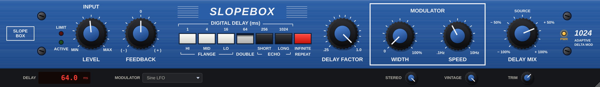

## 1. Introduzione

Slopebox 1024 è un plugin di delay, flanger e modulazione che ricrea il carattere di un rack digitale dei primi anni '80 basato sulla **modulazione delta adattiva** (ADM). In quegli apparecchi l'audio non veniva campionato in parole a 12 o 16 bit, ma in un flusso di singoli bit, letto da una memoria guidata da un unico oscillatore a frequenza variabile. È questo che dà il suono tipico: echi che scuriscono a ogni ripetizione, una leggera grana sui transienti, flanger e chorus che cambiano davvero il pitch come un nastro a velocità variabile.

Il plugin segue lo schema a blocchi del manuale dell'apparecchio originale. Il tono degli echi è stato calibrato su registrazioni dell'unità vera (vedi la sezione 7).

Formati: **AU**, **VST3** e **Standalone** su macOS; **VST3** e **Standalone** su Windows.

## 2. Installazione

### macOS

1. Copia i file nelle cartelle dei plugin dell'utente:
   - `Slopebox 1024.component` in `~/Library/Audio/Plug-Ins/Components/`
   - `Slopebox 1024.vst3` in `~/Library/Audio/Plug-Ins/VST3/`
   - l'app `Slopebox 1024.app` dove preferisci, per esempio in Applicazioni.
2. Se i file arrivano da un download e macOS li blocca, sblocca la quarantena dal Terminale:

   ```
   xattr -dr com.apple.quarantine ~/Library/Audio/Plug-Ins/Components/"Slopebox 1024.component"
   xattr -dr com.apple.quarantine ~/Library/Audio/Plug-Ins/VST3/"Slopebox 1024.vst3"
   ```

3. Riapri la DAW e fai una nuova scansione dei plugin. In Logic Pro il plugin compare tra gli effetti Audio Units sotto **Slopebox Audio**.

### Windows

1. Copia `Slopebox 1024.vst3` in `C:\Program Files\Common Files\VST3\`.
2. Riapri la DAW e fai una nuova scansione dei plugin.

### Versione Standalone

L'app Standalone serve per provare il suono senza DAW. Al primo avvio apri **Options → Audio/MIDI Settings** e scegli ingresso e uscita. La fascia gialla "Audio input is muted to avoid feedback loop" è una protezione contro il fischio di ritorno: togli il muto dalle impostazioni solo se usi le cuffie.

## 3. Il pannello



La finestra si ridimensiona trascinando l'angolo in basso a destra e mantiene le proporzioni. Su ogni manopola il **doppio clic** riporta il valore di partenza; durante il trascinamento compare il valore esatto.

La parte blu riproduce il pannello frontale dell'apparecchio. La striscia scura in basso contiene i controlli aggiunti dal plugin.

### Ingresso

| Comando | Funzione | Valori |
|-----|----------|-----|
| **INPUT LEVEL** | Guadagno d'ingresso di tutto il sistema. Come sull'originale, è anche il comando principale del livello: regolalo perché il LED LIMIT si accenda solo sui picchi. | da −24 a +26 dB, partenza 0 dB |
| **LED LIMIT** (rosso) | Si accende quando il segnale arriva a 0 dBFS. Oltre ci sono circa 6 dB di margine prima che il limitatore schiacci i picchi. | |
| **LED ACTIVE** (verde) | Indica segnale presente sopra −20 dB. | |

### Rigenerazione

| Comando | Funzione | Valori |
|-----|----------|-----|
| **FEEDBACK** | Quanto segnale ritardato torna all'ingresso della memoria. Al centro (0) nessuna ripetizione. Verso **+** la rigenerazione è in fase, verso **−** in controfase: sul flanger le due metà danno timbri diversi (picchi o buchi sulle stesse frequenze). Al massimo il loop arriva vicino all'autooscillazione senza superarla. | da −100% a +100%, partenza 0 |

### Digital Delay (ms)

Sei tasti a ritenuta scelgono la presa sulla memoria, cioè il ritardo di base. I valori stampati valgono con il DELAY FACTOR a 1.0.

| Tasto | Ritardo a ×1 | Ritardo a ×0,25 | Uso tipico |
|---|---|---|---|
| **1** · FLANGE HI | 1 ms | 0,25 ms | flanger acuto, effetto "jet" |
| **4** · FLANGE MID | 4 ms | 1 ms | flanger classico |
| **16** · FLANGE LO | 16 ms | 4 ms | flanger profondo, risonanze intonate |
| **64** · DOUBLE | 64 ms | 16 ms | raddoppio, chorus, vibrato |
| **256** · ECHO SHORT | 256 ms | 64 ms | slapback, eco breve |
| **1024** · ECHO LONG | 1024 ms | 256 ms | eco lungo |
| **INFINITE REPEAT** (rosso) | | | congela e ripete il contenuto della memoria |

Premere il tasto già acceso lo spegne. **Con tutti i tasti spenti** la memoria è scavalcata: non c'è ritardo e senti solo la sorgente.

**INFINITE REPEAT** stacca l'ingresso dalla memoria e fa ricircolare tutto il suo contenuto, bit per bit, senza perdite. La durata del loop è sempre quella dell'intera memoria, cioè 1024 ms × DELAY FACTOR, qualunque tasto sia acceso. Girando il DELAY FACTOR mentre il repeat è attivo il loop si accorcia o si allunga e il pitch sale o scende, fino a due ottave. La sorgente continua a passare secondo il DELAY MIX, quindi puoi suonarci sopra.

### Delay Factor

| Comando | Funzione | Valori |
|-----|----------|-----|
| **DELAY FACTOR** | Moltiplica il ritardo del tasto acceso. Il ritardo reale è *tasto × fattore*: per esempio 1024 ms a 0,5 danno 512 ms. Cambiarlo mentre suona cambia anche il pitch degli echi già in memoria, come un nastro che accelera. | da ×0,25 a ×1,0, partenza ×1,0 |

### Modulator

| Comando | Funzione | Valori |
|-----|----------|-----|
| **WIDTH** | Miscela il comando dell'oscillatore tra il DELAY FACTOR e il modulatore. A 0 il ritardo è fisso; aumentando, il modulatore lo fa oscillare sempre di più. Al 100% conta solo il modulatore, lo sweep copre circa 5:1 e il DELAY FACTOR non ha più effetto. | da 0 a 100%, partenza 0 |
| **SPEED** | Velocità del modulatore (LFO). | da 0,1 a 10 Hz, partenza 0,5 Hz |

### Delay Mix

| Comando | Funzione | Valori |
|-----|----------|-----|
| **DELAY MIX** | Miscela tra sorgente e segnale ritardato. Al centro (**SOURCE**) senti solo la sorgente. Verso **+100%** solo il ritardato, in fase; verso **−100%** solo il ritardato, in controfase. A ±50% sorgente e ritardato hanno lo stesso livello. Le due metà danno flanger di carattere diverso: con il segno + i notch cadono su certe frequenze, con il segno − su altre e la fondamentale si svuota. | da −100% a +100%, partenza +50% |

### Striscia inferiore

| Comando | Funzione | Valori |
|-----|----------|-----|
| **DELAY** (display) | Ritardo effettivo in quel momento, LFO compreso. Mostra "--" quando nessun tasto è acceso. | in ms |
| **MODULATOR** | Sorgente della modulazione. **Sine LFO** come l'originale; **Triangle LFO** per uno sweep a velocità costante; **Envelope**: è il livello del segnale a muovere il ritardo (più suoni forte, più il ritardo si accorcia), al posto di un envelope follower collegato all'ingresso di controllo dell'apparecchio. | Sine LFO, Triangle LFO, Envelope |
| **STEREO** | Quantità di stereo sintetizzato sull'uscita destra. A 0 le due uscite sono uguali (mono). | da 0 a 100%, partenza 100% |
| **VINTAGE** | Al 100% il segnale passa per la conversione ADM completa, con la sua grana. A 0 la stessa catena (tempi, filtri, modulazione) lavora su una memoria "pulita". | da 0 a 100%, partenza 100% |
| **TRIM** | Livello d'uscita del plugin, utile perché l'originale non ne aveva uno. | da −24 a +12 dB, partenza 0 dB |

## 4. Flusso del segnale

1. **INPUT LEVEL** porta il segnale al livello di lavoro. I LED LIMIT e ACTIVE lo misurano qui.
2. **Pre-enfasi**: gli acuti vengono alzati prima della conversione per coprire il rumore, e riabbassati alla fine.
3. Il segnale si somma alla **rigenerazione** e passa per il filtro anti-alias.
4. Il **modulatore delta adattivo** lo trasforma in un flusso a 1 bit. Quando il segnale cambia troppo in fretta per il passo del convertitore, i transienti si ammorbidiscono: è la "grana" tipica.
5. I bit entrano nella **memoria** da 256 Kbit. Il tasto scelto decide in che punto la leggi.
6. Un unico **oscillatore** (VCO) da 256 kHz a 1,024 MHz fa da clock a convertitore, memoria e decoder. È comandato dal DELAY FACTOR e dal modulatore, miscelati dal WIDTH. Siccome il ritardo dipende dal clock, cambiarlo cambia anche il pitch.
7. Il **decoder** ricostruisce l'audio, che passa per il filtro di ricostruzione e la de-enfasi.
8. Una parte del segnale ritardato torna all'ingresso attraverso il **FEEDBACK**. Nel percorso c'è un filtro dolce che toglie un po' di acuti a ogni giro.
9. Il **DELAY MIX** miscela sorgente e segnale ritardato. L'uscita destra riceve lo **stereo sintetizzato**: i bassi restano in fase, medi e acuti vengono sfasati.
10. Il **TRIM** regola il livello finale.

Con INFINITE REPEAT attivo, al punto 5 l'ingresso viene staccato e la memoria gira su se stessa.

## 5. Impostazioni di esempio

Le posizioni delle manopole sono date come sul pannello. Le impostazioni seguono gli esempi del manuale originale.

| Effetto | Impostazioni | Note |
|-----|----------|-----|
| **Flanger** | Tasto 4 (FLANGE MID), WIDTH 100%, SPEED 0,2 Hz, FEEDBACK 0, DELAY MIX +50% | Il classico sweep lento. Con il tasto 1 è più acuto e metallico, con il 16 più profondo. |
| **Flanger con rigenerazione** | Tasto 4, WIDTH 100%, SPEED 0,15 Hz, FEEDBACK +90%, DELAY MIX +50% | Sweep risonante. Prova FEEDBACK −90% e DELAY MIX −50% con il tasto 1 per il suono "jet" in controfase. |
| **Raddoppio** | Tasto 64 (DOUBLE), DELAY FACTOR 0,5 (circa 30 ms), WIDTH 8%, SPEED 0,3 Hz, DELAY MIX +50% | Una seconda voce leggermente staccata e mossa. |
| **Chorus** | Tasto 64, DELAY FACTOR 0,3, WIDTH 15%, SPEED 0,6 Hz, FEEDBACK +30%, DELAY MIX +50% | Più denso del raddoppio, adatto a chitarre pulite e pad. |
| **Vibrato** | Tasto 64, DELAY FACTOR 0,5, WIDTH 12%, SPEED 5 Hz, DELAY MIX +100% | Solo segnale ritardato: il pitch oscilla. |
| **Risonanza intonata** | Tasto 16 (FLANGE LO), DELAY FACTOR tra 0,5 e 0,75, FEEDBACK al massimo, DELAY MIX +100% | Il loop risuona su una nota: il DELAY FACTOR la intona. Ottimo su percussioni. |
| **Slapback** | Tasto 256 (ECHO SHORT), DELAY FACTOR 0,5 (circa 130 ms), DELAY MIX +35% | Un solo eco breve, stile rockabilly. |
| **Eco con ripetizioni** | Tasto 1024 (ECHO LONG), DELAY FACTOR 0,4 (circa 410 ms), FEEDBACK +60%, DELAY MIX +40% | Gli echi scuriscono a ogni ripetizione come sull'originale. |
| **Infinite repeat** | Tasto 1024, DELAY FACTOR 1,0, suona una frase di circa un secondo, poi premi INFINITE REPEAT | Il loop gira all'infinito. Abbassa il DELAY FACTOR per alzarlo di pitch, fino a due ottave. |
| **Sweep a inviluppo** | Tasto 4, MODULATOR Envelope, WIDTH 100%, FEEDBACK +70%, DELAY MIX +50% | Il flanger segue la dinamica: ogni colpo fa partire lo sweep. |

## 6. Consigli

- **Regola prima l'ingresso.** Come sull'apparecchio, il suono dipende dal livello: con il LED LIMIT che lampeggia sui picchi ottieni la dinamica migliore. Spingendo oltre, il convertitore e il limitatore aggiungono una saturazione che a volte è proprio quello che serve.
- **Usa il TRIM per il livello d'uscita**, non l'INPUT LEVEL: cambiando l'ingresso cambi anche il carattere.
- **In mandata o in insert.** In una mandata (aux) metti il DELAY MIX a +100% e regola la quantità con la mandata della DAW. In insert usa il DELAY MIX come sull'hardware.
- **Pitch "a nastro".** Girare il DELAY FACTOR durante gli echi produce i glissati tipici delle macchine a clock variabile. Automatizzalo nella DAW per effetti dub.
- **Flanger: + o −.** Se un flanger suona vuoto o troppo nasale, prova a invertire il segno del FEEDBACK o del DELAY MIX.
- **Feedback al massimo.** Sui tasti corti il feedback alto crea risonanze forti: abbassa l'INPUT LEVEL o il TRIM se il livello sale troppo.
- **Mono o stereo.** Su tracce che devono restare compatibili in mono porta lo STEREO a 0.
- **VINTAGE a 0** è utile per capire quanto della grana viene dalla conversione: è un confronto, non il suono dell'originale.

## 7. Differenze dall'originale

Slopebox 1024 non è una copia del circuito: è un modello del suo schema a blocchi. Le scelte principali:

- **Calibrazione.** Il tono della rigenerazione è stato regolato misurando registrazioni dell'apparecchio vero: a ogni ripetizione gli echi perdono circa 1 dB a 4 kHz e 3 dB a 8 kHz rispetto a 1 kHz, come l'originale. Anche le gamme del flanger, la forma dello sweep e la durata del repeat corrispondono alle misure. Il rumore di fondo e il comportamento del limitatore non si potevano misurare con precisione da quelle registrazioni e restano stimati.
- **Controlli aggiunti.** STEREO, VINTAGE, TRIM, il display del ritardo e la scelta del modulatore (Triangle LFO ed Envelope) non esistono sull'apparecchio.
- **Ingressi di controllo.** L'originale aveva un ingresso per comandare il VCO dall'esterno e prese per pedali. Nel plugin la modalità Envelope sostituisce l'uso più comune dell'ingresso di controllo; repeat e bypass si comandano automatizzando i parametri nella DAW.
- **Livelli.** Il riferimento è 0 dBFS al posto dei livelli di linea analogici. Il limitatore interviene circa 6 dB sopra il LED LIMIT, come indicato dal manuale originale.
- **Nome e grafica.** Pannello e nomi sono originali del plugin: non contengono marchi o loghi del produttore dell'apparecchio.

## 8. Specifiche

| Voce | Valore |
|---|---|
| Ritardi (tasti) | 1, 4, 16, 64, 256, 1024 ms a ×1; da ×0,25 a ×1 con il DELAY FACTOR |
| Ritardo minimo / massimo | 0,25 ms / 1024 ms |
| Memoria | 262.144 celle a 1 bit (256 Kbit) |
| Clock (VCO) | da 256 kHz (×1) a 1,024 MHz (×0,25) |
| Modulatore | Sine LFO, Triangle LFO (0,1–10 Hz), Envelope; sweep massimo circa 5:1 |
| Conversione | Modulazione delta adattiva a 1 bit con pre-enfasi e de-enfasi |
| Banda passante del convertitore | 20 kHz |
| Feedback | bipolare, guadagno massimo 0,97 |
| Infinite repeat | intera memoria, 1024 ms × DELAY FACTOR, senza perdite |
| Ingresso / uscita | stereo in, stereo out (destra sintetizzata); funziona anche con ingresso mono |
| Latenza | nessuna |
| Formati | AU, VST3, Standalone (macOS); VST3, Standalone (Windows) |

<p class="footer-note">Slopebox 1024 · Slopebox Audio. I nomi dei prodotti citati appartengono ai rispettivi proprietari; questo plugin non è affiliato né approvato da loro.</p>
